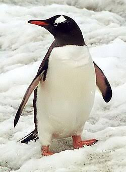

# El Pingüino: Adaptación y Superación en los Climas Más Extremos

## Introducción
Los pingüinos son una familia de aves marinas no voladoras que habitan casi exclusivamente en el Hemisferio Sur. A lo largo de millones de años, estas fascinantes criaturas han cambiado sus alas por aletas altamente eficientes, convirtiéndose en unos de los nadadores más ágiles del reino animal. Su vida transcurre dividida entre la tierra firme, donde se reproducen y mudan su plumaje, y los océanos, donde cazan para subsistir.

A diferencia de otras aves, los pingüinos han desarrollado adaptaciones anatómicas únicas para soportar las gélidas temperaturas de sus entornos. Su cuerpo está cubierto por varias capas de plumas densas y superpuestas que atrapan el aire para actuar como un aislante térmico natural. Además, poseen una gruesa capa de grasa bajo la piel que les ayuda a conservar el calor corporal incluso en las aguas más frías de la Antártida.

Su estructura social es una de las más complejas y llamativas de la naturaleza, recurriendo a cantos e interacciones grupales para identificar a sus parejas y crías en medio de colonias masivas. El estudio de sus comportamientos no solo fascina a la comunidad científica, sino que también sirve como un indicador crucial para medir la salud de los ecosistemas marinos globales.

## Historia Evolutiva del Pingüino
Los ancestros de los pingüinos modernos divergieron de las aves voladoras hace aproximadamente 60 millones de años, poco después de la extinción de los dinosaurios. Los registros fósiles revelan la existencia de especies gigantescas en el pasado, como el *Palaeeudyptes marplesi*, que podía llegar a medir casi dos metros de altura. Con el paso del tiempo, el tamaño de las especies se redujo y optimizó, adaptándose a las corrientes marinas actuales y especializándose en la captura de kril, peces y calamares.

## Importancia Ecológica
Los pingüinos desempeñan un rol fundamental como depredadores intermedios en la cadena alimenticia oceánica. Al consumir grandes cantidades de biomasa marina y trasladar nutrientes hacia la tierra a través de sus desechos (guano), fertilizan los suelos de las islas y costas donde anidan. Además, al ser muy sensibles a las fluctuaciones de temperatura y la disponibilidad de alimento, actúan como centinelas biológicos frente a los efectos del cambio climático.

## Ideas Principales sobre su Comportamiento
1. Monogamia estacional o prolongada en la mayoría de las especies para garantizar el éxito de la crianza.
2. Incubación compartida donde tanto el macho como la hembra se turnan para proteger el huevo.
3. Técnicas de caza cooperativa en el agua para rodear grandes bancos de peces pequeños.
4. Uso de la termorregulación grupal mediante compactaciones masivas para protegerse del viento polar.

## Curiosidades y Ejemplos de Especies
- **Pingüino Emperador:** Es la especie más grande y el único que se reproduce durante el crudo invierno antártico.
- **Pingüino de Galápagos:** La única especie que logra vivir al norte del ecuador gracias a las corrientes frías de Humboldt y Cromwell.
- **Camuflaje natural:** Su coloración blanca en el vientre y negra en el lomo (contrailuminación) los oculta de depredadores tanto desde el aire como desde el fondo del mar.
- **Glándula especial:** Poseen una glándula supraorbital que les permite filtrar el exceso de sal de la sangre, permitiéndoles beber agua marina.

## Conclusión
Los pingüinos representan uno de los ejemplos más extraordinarios de especialización biológica y resiliencia en nuestro planeta. Sin embargo, la alteración de sus hábitats por la pesca comercial, la contaminación por plásticos y el calentamiento global amenazan la supervivencia de varias de sus especies. Proteger a estos embajadores del océano es un paso indispensable para conservar el equilibrio de las aguas antárticas y subantárticas.

Más información detallada en la [Wikipedia sobre los Pingüinos](https://es.wikipedia.org/wiki/Spheniscidae).
